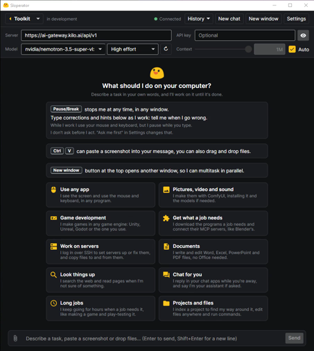

# Sloperator
An AI that uses your Windows PC for you. Say what you want; it looks at the screen, clicks, types and
runs things until it's done. One portable exe, nothing installed.

## Start
Grab `Sloperator.exe` from [Releases](https://github.com/forcepusher/Sloperator/releases), run it, type
a task. Windows says "protected your PC"? **More info** → **Run anyway**. **Pause/Break** stops it.

## Models
- **Free:** works out of the box on Kilo's free models. No key, about 200 requests an hour.
- **Claude:** server `api.anthropic.com` + your API key.
- **Local:** LM Studio's server at `http://localhost:1234/v1`, a model that sees images (Qwen3.8 27B).
- **Anything else OpenAI-compatible:** its address + key.

## Build
.NET 10 SDK: `dotnet build`, `dotnet test`, `./scripts/publish.ps1`. How it all works:
[docs/notes.md](docs/notes.md).
