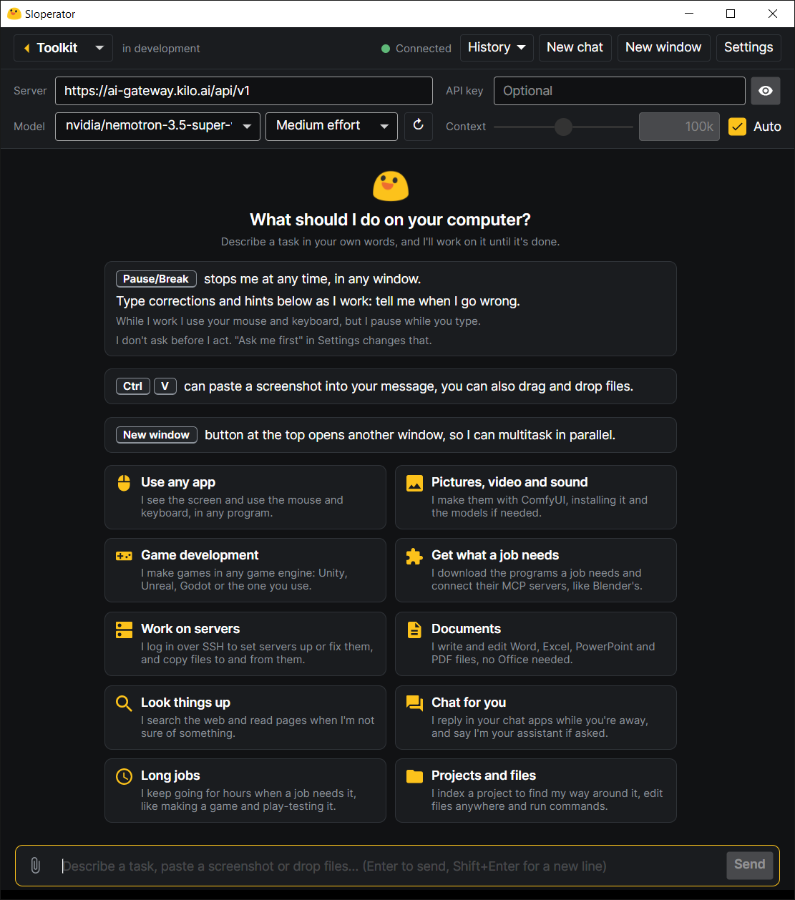

# BlackBox
BlackBox does work on your Windows PC for you. Tell it what you want in plain words, and an AI model
does it the way a person would: it looks at the screen, clicks, types, edits files and runs commands
until the job is done.



It is a single portable `BlackBox.exe`. Nothing gets installed: its settings, chats, films and
whatever it downloads stay in a `Data` folder next to the exe.

## What it can do
- **Use any app.** It sees the screen and uses the mouse and keyboard, in any program.
- **Pictures, video and sound.** It makes them with ComfyUI, installing ComfyUI and the models if needed.
- **Films.** Pick **Filmmaking** in the **Toolkit** dropdown at the top left: it opens on the left
  of the chat with the film on a timeline: References (pictures), takes, lines and sound tracks.
  Right-click a row to create something there, then pick **File…** to copy in a file of yours or
  **Generate** to have BlackBox make it; you can also drop files on the timeline. The film's name at
  the top opens your other films. Click anything on the timeline to put it in your message, and say
  what you want in plain words (with nothing picked, it is about the whole film). BlackBox writes the
  prompts, picks the models, makes it and looks at it, in the chat, where you can watch it and stop
  it; right-click a piece to get an earlier version back. Or just ask for a film in the chat.
- **See what changed.** Pick **Code changes** in the **Toolkit** dropdown: it opens on the left of the chat
  with every file the agent changes in the chat, beside its diff, as it works. Click lines
  (Shift+click for a range, Ctrl+click for more) to put them in your message, then ask about them or
  have them changed.
- **Game development.** It makes games in any engine (Unity, Unreal, Godot) and play-tests them.
- **Know your projects.** Before it works on a project or a big folder, it indexes it, as Cursor
  does: what is in it, what its files define, and a search that finds where anything is.
- **Documents.** It writes and edits Word, Excel, PowerPoint and PDF files, no Office needed.
- **Servers.** It logs in over SSH to set servers up or fix them.
- **Chat for you.** It replies in your chat apps while you're away, and says it's your assistant if asked.
- **Look things up.** It searches the web and reads pages when it isn't sure of something.
- **Get what a job needs.** It downloads the programs a job needs and connects MCP servers, like Blender's.
- **Long jobs.** It keeps going for hours when a job needs it.

## Getting started
1. Put `BlackBox.exe` in a folder of your own (Documents, the Desktop, a USB stick), not in
   Program Files. To make the exe yourself, see [Building](#building).
2. Double-click it. If Windows says "Windows protected your PC", click **More info**, then
   **Run anyway**.
3. Type what you want done and press Enter.

Out of the box it runs on Kilo's free online models, with no account or key. They allow about 200
requests an hour, so a long job may stop to wait, and your screenshots go to their servers. For
private or long work, use your own model.

## While it works
- **Pause/Break** (or the Stop button) stops it at any time, from any window.
- Type in the box to correct it or add to the task. It holds off the mouse and keyboard while you type.
  Your message waits above the box until it reads it: × takes it back, and **Interrupt the model**
  (or Ctrl+Enter) has it read right away, cutting short what it was thinking or running.
- Click a picture or video in the chat to see it full screen. **Prompt** under one made with ComfyUI
  (or AUTOMATIC1111) shows the prompts and settings it was made with.
- Paste a screenshot or files with Ctrl+V, or drop them on the window, to send them with a message.
- **History** keeps every chat, so you can come back to one and carry on.
- **Several tasks at once:** **New window** at the top (or starting BlackBox again) opens another
  window with a chat of its own. The windows take turns with the
  mouse and keyboard, and Pause/Break stops them all.
- It doesn't ask before it acts. To approve each step, use "Ask me first" in Settings.
- Every error it shows is also written to `Data\errors.log`, with the details, so you can look at
  it (or send it along) later.

## Using your own model
Type your server's address in the bar at the top of the window, such as `http://localhost:1234/v1`
for LM Studio, and an API key next to it if the server needs one. Any OpenAI-compatible server works:
LM Studio, llama.cpp, Ollama, vLLM, OpenRouter and other online APIs. BlackBox picks the strongest
model the server has, or you pick one from the list.

- In LM Studio, switch its server on in the Developer tab, and turn on "Serve on Local Network"
  if BlackBox runs on another PC.
- To use the screen, the model has to see images (Qwen3.5 VL or later, Gemma 4 with its vision
  projector). Most testing was done with Qwen3.8 27B.
- For Claude, type `api.anthropic.com` and your Anthropic API key. BlackBox speaks Anthropic's own
  API, so Claude keeps its thinking and most of each step comes from its cheaper cache. It uses
  Claude Opus 5.5 unless you pick another, with its whole 1M context; a long job costs more with
  a bigger context, so set a smaller one by hand if you prefer.
- The effort dropdown next to the model says how hard the model thinks (medium unless you pick
  another). It is greyed out for models whose server doesn't say they take one.
- Give the model at least 32k of context.
- In LM Studio, turn off the model's "Image Input: Never exceed 2048 px" option. Otherwise
  screenshots get shrunk and clicks miss more often.

## Building
You need Windows and the .NET 10 SDK.

```powershell
dotnet build             # debug build, keeps its Data in .dev/
dotnet test              # unit tests
./scripts/publish.ps1    # makes publish/BlackBox.exe
```

How each part works and why, the test scripts and the benchmark results are in
[docs/notes.md](docs/notes.md).
